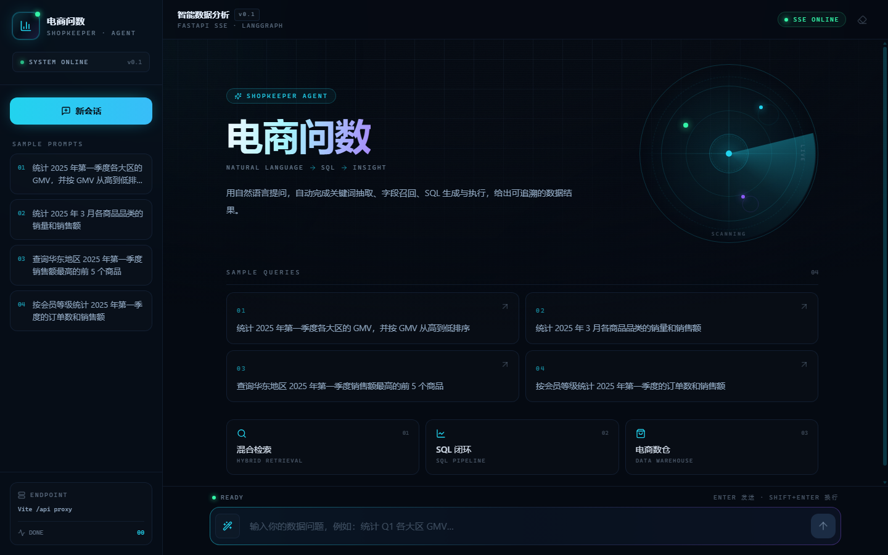
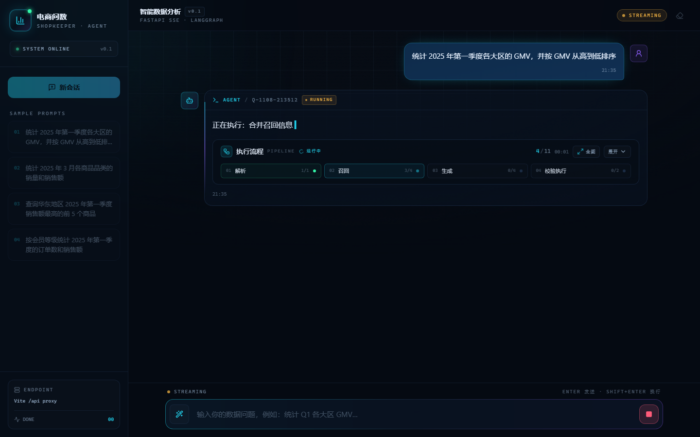
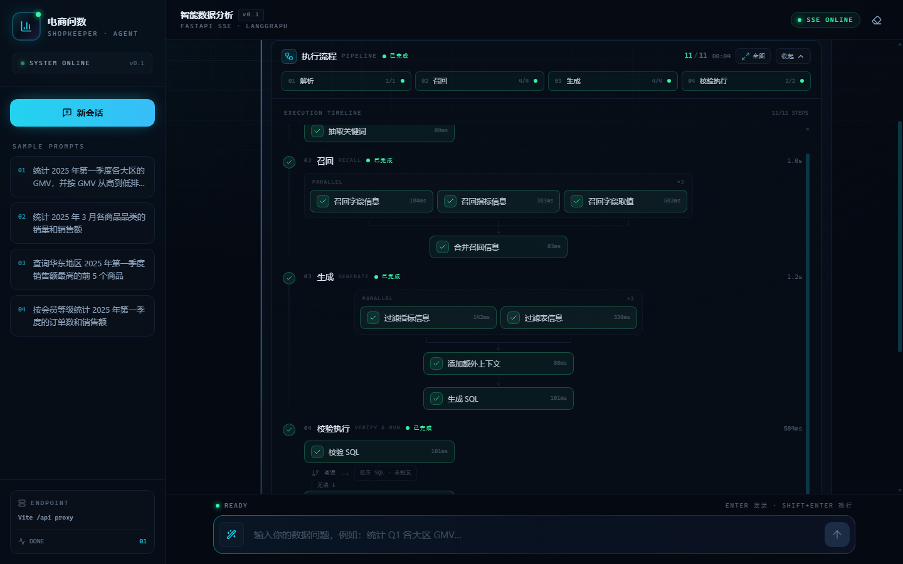
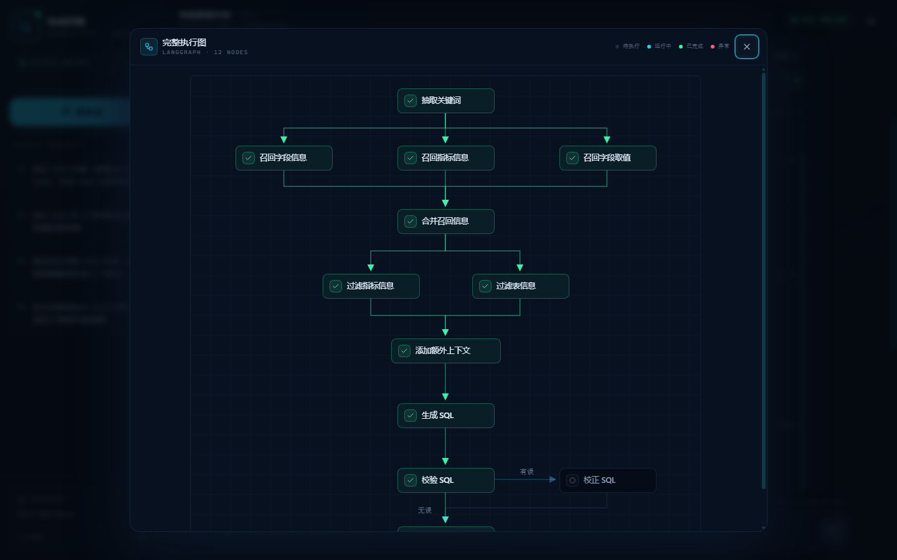
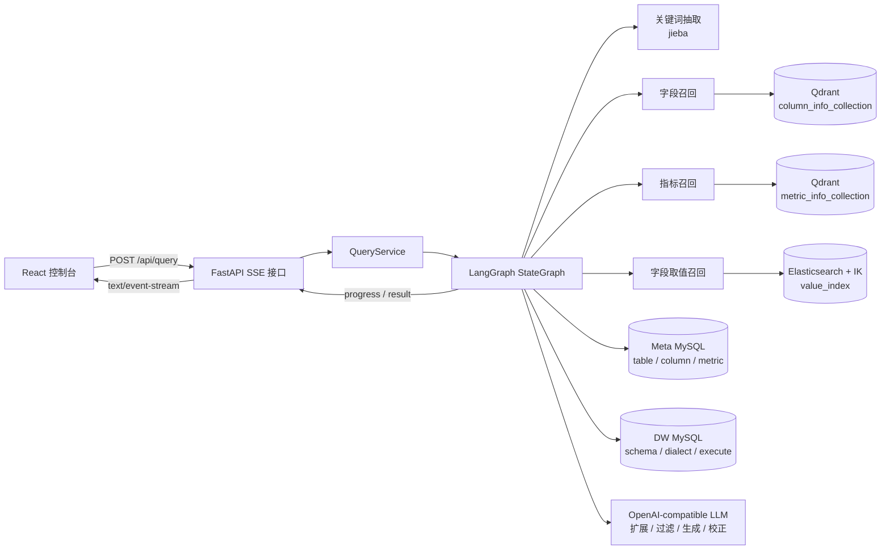
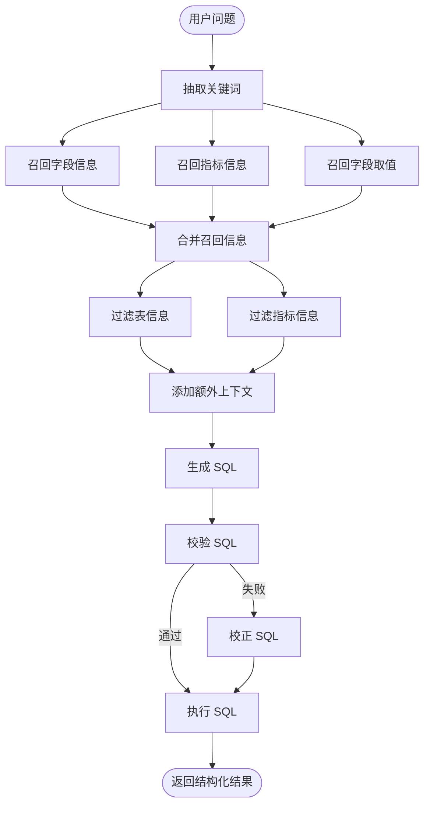

<div align="center">

# 电商问数智能体 · Shopkeeper Agent

**把自然语言问题变成一条可执行、可观测的 Text-to-SQL 链路。**

一个面向电商数仓的问数 Agent：用户用中文提问，系统自动完成关键词抽取、字段/指标/取值召回、SQL 生成、校验、纠错与执行，并通过 SSE 实时展示 Agent 的每一步执行状态。

[](https://www.python.org/)
[](https://fastapi.tiangolo.com/)
[](https://langchain-ai.github.io/langgraph/)
[](https://react.dev/)
[](https://vite.dev/)
[](https://tailwindcss.com/)


[项目简介](#项目简介) · [界面预览](#界面预览) · [系统架构](#系统架构) · [快速开始](#快速开始) · [API](#api) · [已知限制](#已知限制)

</div>

---

## 项目简介

电商问数智能体面向运营、分析师和业务同学，解决“知道要什么数据，但不会写 SQL”的问题。用户只需输入业务问题，例如：

> 统计 2025 年第一季度各大区的 GMV，并按 GMV 从高到低排序

系统会沿一条 12 节点的 LangGraph 工作流完成：

1. 用 jieba 抽取问题关键词；
2. 并行执行字段、指标、字段取值三路召回；
3. 合并候选表/字段/指标，补齐主外键和真实取值；
4. 过滤无关表和指标，补充日期与数据库方言；
5. 调用大模型生成 SQL；
6. 用 `EXPLAIN` 校验，失败则进入 SQL 校正；
7. 执行 SQL，把结构化结果和每一步进度通过 SSE 推给前端。

前端是一个深色科技风控制台，实时呈现阶段化执行流程、查询结果表格和完整 LangGraph 拓扑。

> 当前版本定位为 **MVP / 学习型项目**，接口和数据结构可能继续调整；生产使用前请阅读 [安全提示](#安全提示) 与 [已知限制](#已知限制)。

---

## 界面预览

| 首页 | 对话与阶段化执行流程 |
| :---: | :---: |
|  |  |

| 展开后的执行时间轴 | 完整 LangGraph 执行图 |
| :---: | :---: |
|  |  |

> 截图为演示数据，实际结果取决于你构建的元数据、数仓数据和模型输出。

---

## 核心能力

- **自然语言问数**：中文业务问题 → 元数据召回 → SQL → 结果表格。
- **12 节点 LangGraph 工作流**：三路并行召回、表/指标双路过滤、SQL 校验/校正/执行，节点可观察、可扩展。
- **混合召回链路**：MySQL 元数据 + Qdrant 向量检索 + Elasticsearch IK 全文检索 + jieba/Embedding，分别覆盖字段、指标和真实字段值。
- **SQL 闭环**：LLM 生成 SQL → `EXPLAIN` 校验 → 自动校正 → 执行并结构化返回。
- **实时执行反馈**：SSE 推送 `progress / result / error` 事件；前端以阶段化 Live Pipeline 展示执行状态。
- **结果展示**：查询结果表格、CSV 导出、查询编号和移动端适配。
- **可复现的本地基础设施**：Docker Compose 一键启动 MySQL、Elasticsearch + IK、Qdrant、TEI Embedding 服务。
- **元数据知识库构建脚本**：从 `meta_config.yaml` 声明式同步表、字段、指标、字段值到 MySQL/Qdrant/ES。

---

## 系统架构



**关键设计**

- `QueryService` 只负责组装一次查询的运行时上下文（`DataAgentContext`），并把 LangGraph 的 `custom` 流转换成 SSE。
- `DataAgentState` 保存问题、关键词、召回结果、表/指标上下文、SQL 和校验错误；外部客户端不进入 State。
- 字段/指标用 Qdrant 做语义召回，字段取值用 Elasticsearch + IK 做全文召回，元数据补齐和 SQL 执行分别走 Meta MySQL / DW MySQL。
- 前端用 `ReadableStream` 解析 SSE，把 `progress` 写入阶段化步骤条，把 `result` 渲染为结果表格。

---

## Agent 工作流



| 阶段 | 节点 | 说明 |
| --- | --- | --- |
| 解析 | 抽取关键词 | jieba TF-IDF + 词性过滤，保留原始问题作为兜底 |
| 召回 | 字段 / 指标 / 取值 | LLM 扩展关键词；字段/指标查 Qdrant，取值查 ES |
| 合并 | 合并召回信息 | 补齐指标依赖字段、真实取值、主外键与表结构 |
| 过滤 | 过滤表 / 过滤指标 | LLM 只做选择，程序负责裁剪上下文 |
| 生成 | 添加额外上下文 + 生成 SQL | 注入日期、季度、数据库方言/版本；LLM 生成 SQL |
| 校验执行 | 校验 / 校正 / 执行 | `EXPLAIN` 校验，失败进入校正，最后执行并返回 |

工作流定义见 [`app/agent/graph.py`](app/agent/graph.py)，状态与上下文分别见 [`app/agent/state.py`](app/agent/state.py) 和 [`app/agent/context.py`](app/agent/context.py)。

---

## 技术栈

| 模块 | 技术 |
| --- | --- |
| 前端 | React 19、TypeScript、Vite 6、Tailwind CSS 3.4、lucide-react |
| 后端 | Python 3.14、FastAPI、Uvicorn、Pydantic、Loguru、OmegaConf |
| Agent | LangGraph、LangChain、OpenAI-compatible Chat Model |
| 检索 | MySQL 8 元数据、Qdrant 1.16、Elasticsearch 8.19 + IK、jieba、BAAI/bge-large-zh-v1.5 |
| 数据访问 | SQLAlchemy 2.x async、asyncmy |
| 基础设施 | Docker Compose、Hugging Face Text Embeddings Inference (TEI) |
| 工具链 | uv、pnpm 10 |

---

## 目录结构

```text
.
├── app/
│   ├── agent/                 # LangGraph 图、状态、上下文、12 个执行节点
│   ├── api/                   # FastAPI 路由、依赖、SSE 生命周期
│   ├── clients/               # MySQL / ES / Qdrant / Embedding 客户端管理器
│   ├── conf/                  # 应用配置与元数据配置的 dataclass
│   ├── entities/              # 表、字段、指标、取值等领域实体
│   ├── models/                # SQLAlchemy ORM 模型
│   ├── repositories/          # MySQL / ES / Qdrant 数据访问层
│   ├── services/              # QueryService、MetaKnowledgeService
│   └── scripts/               # build_meta_knowledge.py 元数据构建入口
├── conf/
│   ├── app_config.yaml        # 数据库、Qdrant、Embedding、ES、LLM 配置
│   └── meta_config.yaml       # 要同步的表、字段、指标声明
├── docker/
│   ├── docker-compose.yml     # MySQL / ES / Kibana / Qdrant / TEI
│   ├── mysql/                 # meta.sql / dw.sql 初始化脚本
│   ├── elasticsearch/         # ES 8.19.10 + IK 插件镜像
│   └── embedding/             # 本地 BGE 模型目录（不提交大文件）
├── frontend/
│   ├── src/                   # React 页面、组件、SSE 客户端
│   ├── preview/               # README 界面截图
│   └── vite.config.ts         # 开发代理 /api -> :8000
├── prompts/                   # LLM 提示词模板
├── .env.example               # 环境变量模板
├── main.py                    # FastAPI 应用入口
├── pyproject.toml
└── uv.lock
```

---

## 快速开始

### 前置要求

- **Python 3.14+**（项目通过 `.python-version` 锁定 3.14）
- **uv**：依赖与虚拟环境管理
- **Node.js 20+ / pnpm 10**
- **Docker Desktop**（MySQL、Elasticsearch、Qdrant、TEI；建议至少 8 GB 内存）
- 一个 **OpenAI-compatible LLM API Key**（DeepSeek / Qwen / 其他兼容服务均可）

### 1. 克隆仓库

```bash
git clone <your-repo-url>
cd shopping-sum
```

### 2. 配置环境变量

```bash
cp .env.example .env
# 编辑 .env，填入 LLM_API_KEY
```

Windows PowerShell：

```powershell
Copy-Item .env.example .env
```

### 3. 安装后端依赖

```bash
uv sync
```

如果本机没有 Python 3.14：

```bash
uv python install 3.14
uv sync
```

### 4. 下载 Embedding 模型

模型权重不随仓库提交（`docker/embedding/` 已在 `.gitignore` 中），需要先下载：

```bash
uv run hf download BAAI/bge-large-zh-v1.5 \
  --local-dir docker/embedding/bge-large-zh-v1.5
```

> 如果当前 `huggingface-hub` 版本没有 `hf` 命令，可以使用
> `uv run huggingface-cli download BAAI/bge-large-zh-v1.5 --local-dir docker/embedding/bge-large-zh-v1.5`。
>
> 模型约 1.3 GB，首次下载耗时较长；下载完成后 TEI 服务才能正常提供 1024 维向量。

### 5. 启动基础设施

```bash
docker compose -f docker/docker-compose.yml up -d
docker compose -f docker/docker-compose.yml ps
```

默认端口：

| 服务 | 端口 |
| --- | --- |
| MySQL | `3307` |
| Elasticsearch | `9200` |
| Kibana | `5601` |
| Qdrant HTTP / gRPC | `6333` / `6334` |
| TEI Embedding | `8081` |

MySQL 首次启动会执行 `docker/mysql/meta.sql` 和 `docker/mysql/dw.sql`，创建 `meta` / `dw` 两个库并写入示例电商数据。

> 如果修改了初始化 SQL 或需要重置数据：
>
> ```bash
> docker compose -f docker/docker-compose.yml down -v
> docker compose -f docker/docker-compose.yml up -d
> ```

### 6. 构建元数据知识库

确保 MySQL、Qdrant、ES、TEI 已就绪，然后执行：

```bash
uv run python -m app.scripts.build_meta_knowledge -c conf/meta_config.yaml
```

该脚本会：

- 从 DW 读取字段类型和样例值；
- 将表、字段、指标写入 Meta MySQL；
- 创建 Qdrant `column_info_collection` / `metric_info_collection` 并写入向量；
- 创建 Elasticsearch `value_index`，为需要同步的字段值建立 IK 全文索引。

`conf/meta_config.yaml` 控制同步范围；可以按同样的 YAML 结构继续添加表、字段和指标。

### 7. 启动后端

```bash
uv run uvicorn main:app --reload --host 0.0.0.0 --port 8000
```

- Swagger UI：<http://127.0.0.1:8000/docs>
- OpenAPI JSON：<http://127.0.0.1:8000/openapi.json>

### 8. 启动前端

```bash
cd frontend
pnpm install
pnpm dev
```

访问 <http://localhost:5173>。

开发环境下 Vite 会把 `/api` 代理到 `http://127.0.0.1:8000`；如需修改后端地址，复制并编辑 `frontend/.env.example`：

```bash
cp .env.example .env
# VITE_DEV_PROXY_TARGET=http://127.0.0.1:8000
```

---

## 配置说明

| 文件 | 作用 |
| --- | --- |
| `.env` | 仅保存 `LLM_API_KEY`，已被 `.gitignore` 忽略 |
| `.env.example` | 环境变量模板，复制为 `.env` 后填写 |
| `conf/app_config.yaml` | 数据库、Qdrant、Embedding、Elasticsearch、LLM 配置 |
| `conf/meta_config.yaml` | 声明要同步到知识库的表、字段、指标 |
| `frontend/.env` | 前端代理地址 / 独立部署时的 API Base URL |
| `docker/docker-compose.yml` | 基础设施端口、账号、镜像与卷 |

`conf/app_config.yaml` 的核心结构：

```yaml
db_meta:
  host: localhost
  port: 3307
  user: your_user
  password: your_password
  database: meta

db_dw:
  host: localhost
  port: 3307
  user: your_user
  password: your_password
  database: dw

qdrant:
  host: localhost
  port: 6333
  embedding_size: 1024

embedding:
  host: localhost
  port: 8081
  model: BAAI/bge-large-zh-v1.5

llm:
  model_name: your-model
  api_key: ${oc.env:LLM_API_KEY}
  base_url: https://your-openai-compatible-endpoint/v1
```

注意事项：

- `qdrant.embedding_size` 必须与 Embedding 模型输出维度一致；`bge-large-zh-v1.5` 为 **1024**。
- `llm.base_url` 需要是 OpenAI-compatible 接口地址；`llm.model_name` 必须与你的服务实际模型名一致。
- `db_meta` / `db_dw` 的账号必须与 `docker/docker-compose.yml` 中 MySQL 账号一致（或反向修改 Compose）。
- `meta_config.yaml` 中的 `table.name` / `column.name` 必须能在 `dw` 库中找到，否则构建脚本会失败。

`conf/meta_config.yaml` 的最小结构示例：

```yaml
tables:
  - name: fact_order
    role: fact
    description: 订单事实表
    columns:
      - name: order_id
        role: primary_key
        description: 订单编号
        alias: [订单ID]
        sync: false
      - name: order_amount
        role: measure
        description: 订单金额
        alias: [销售额, 成交额]
        sync: false

metrics:
  - name: GMV
    description: 成交总额
    relevant_columns:
      - fact_order.order_amount
    alias: [成交额, 销售额]
```

`sync: true` 的字段会把真实取值同步到 Elasticsearch；主键、金额等不需要枚举检索的字段一般保持 `false`。

---

## API

### `POST /api/query`

接收自然语言问题，返回 `text/event-stream`。

**请求**

```http
POST /api/query HTTP/1.1
Host: 127.0.0.1:8000
Content-Type: application/json
Accept: text/event-stream

{
  "query": "统计 2025 年第一季度各大区的 GMV，并按 GMV 从高到低排序"
}
```

**SSE 事件**

| 事件 | 字段 | 说明 |
| --- | --- | --- |
| `progress` | `step`、`status` | `status` 为 `running` / `success` / `error`；前端据此更新执行流程 |
| `result` | `data` | 查询结果，`list[dict]`，每个 dict 是一行 |
| `error` | `message` | 流式过程中出现异常时的兜底事件 |

单个事件示例：

```text
data: {"type":"progress","step":"抽取关键词","status":"running"}

data: {"type":"progress","step":"抽取关键词","status":"success"}

data: {"type":"progress","step":"召回字段信息","status":"running"}

data: {"type":"progress","step":"召回字段信息","status":"success"}

data: {"type":"result","data":[{"大区":"华东","GMV":12864000},{"大区":"华南","GMV":9642000}]}
```

并行召回节点的进度顺序可能交错；前端按 `step` 聚合状态，不依赖严格顺序。

**cURL 调试**

```bash
curl -N -X POST http://127.0.0.1:8000/api/query \
  -H "Content-Type: application/json" \
  -H "Accept: text/event-stream" \
  -d '{"query":"统计华北地区销售额"}'
```

`-N` 关闭 curl 缓冲，便于观察流式输出。

---

## 开发与验证

### 后端

```bash
# 语法检查
uv run python -m compileall -q app

# 启动开发服务
uv run uvicorn main:app --reload --host 0.0.0.0 --port 8000
```

### 前端

```bash
cd frontend

# TypeScript 类型检查
pnpm lint

# 生产构建
pnpm build
```

当前仓库尚未接入自动化测试与 CI；欢迎补充 `pytest`、前端组件测试和端到端测试。

---

## 常见问题

### 1. 启动时报 `LLM_API_KEY` 缺失 / 401

确认项目根目录存在 `.env`，且包含：

```bash
LLM_API_KEY=sk-...
```

`conf/app_config.yaml` 中的 `api_key` 应保持为 `${oc.env:LLM_API_KEY}`，不要把密钥直接写进 YAML。

### 2. MySQL 连接失败

- 确认容器已启动：`docker compose -f docker/docker-compose.yml ps`
- MySQL 映射到宿主机 **3307**，不是默认的 3306。
- 检查 `conf/app_config.yaml` 的账号/密码是否与 Compose 一致。
- 查看日志：`docker compose -f docker/docker-compose.yml logs -f mysql`

### 3. Embedding 服务 8081 无法访问

- 先确认 `docker/embedding/bge-large-zh-v1.5/` 存在且模型文件完整。
- 查看 TEI 日志：`docker compose -f docker/docker-compose.yml logs -f embedding`
- 模型下载完成后重启：`docker compose -f docker/docker-compose.yml restart embedding`

### 4. 召回结果为空 / 元数据构建失败

- 确认 `docker/mysql/dw.sql` 已初始化，`dw` 库中存在 `meta_config.yaml` 声明的表和字段。
- 重新执行元数据构建脚本，并检查 Qdrant collection、ES `value_index` 是否有数据。
- 检查 `conf/meta_config.yaml` 的字段名、别名和 `sync` 配置。

### 5. 前端请求 404 / CORS

开发环境默认使用 Vite 代理，`/api` 会转发到 `http://127.0.0.1:8000`。如果后端端口不同，修改 `frontend/.env` 中的 `VITE_DEV_PROXY_TARGET`。

生产部署建议让前端和后端同域，通过 Nginx 反向代理 `/api`；当前 `main.py` 没有额外配置 CORS 中间件。

### 6. `uv sync` 提示 Python 版本不满足

项目要求 Python 3.14+：

```bash
uv python install 3.14
uv sync
```

---

## 安全提示

- `.env`、`.venv/`、`logs/` 已被 `.gitignore` 忽略；不要提交真实密钥。
- `conf/app_config.yaml` 和 `docker/docker-compose.yml` 中保留了本地开发用的数据库账号/密码。**提交公开仓库前请替换为自己的占位值或改用环境变量**；如果曾经推送过真实凭据，请轮换密码并清理 Git 历史。
- `db_dw` 建议使用**只读账号**：Agent 会执行模型生成的 SQL，当前没有额外的 SQL 白名单、只读校验或超时保护。
- 当前没有登录、权限、限流和审计能力，不要直接暴露到公网；生产使用时至少加认证、网络隔离和查询超时。

---

## 已知限制

- 单轮问数：暂未实现多轮对话记忆和上下文追问。
- SQL 方言：当前主要面向 MySQL；PostgreSQL 等其他方言需要扩展提示词和校验逻辑。
- 流式粒度：SSE 推送的是节点级进度，不是 token 级文本流。
- SQL 校正：当前只走一次校验 → 校正；复杂错误可能仍需人工介入。
- 前端和后端未配置 CORS；开发依赖 Vite 代理，生产建议同域反向代理。
- 配置中的数据库凭据为本地演示值，公开仓库前必须清理。
- 暂无自动化测试、CI、鉴权、限流和可观测性（trace / 成本统计）。

## Roadmap

- [ ] 增加 `pytest` 单元/集成测试与 GitHub Actions CI
- [ ] SQL 只读校验、超时、结果行数限制与审计日志
- [ ] 登录、权限与多租户
- [ ] 多轮对话与追问
- [ ] PostgreSQL / ClickHouse 方言适配
- [ ] 问数评测集与准确率指标
- [ ] 生产 Docker 镜像与一键部署

---

## 贡献

欢迎提交 Issue 或 PR：

1. Fork 本仓库并从 `main` 创建分支；
2. 保持代码风格与现有结构一致；
3. 提交前运行：
   ```bash
   uv run python -m compileall -q app
   cd frontend && pnpm lint && pnpm build
   ```
4. 不要提交 `.env`、模型权重、日志或本地数据库数据；
5. 在 PR 中说明改动动机、测试方式和影响范围。

---

## License

本项目目前未声明开源许可证。若计划公开分发，建议补充 `LICENSE` 文件（例如 MIT 或 Apache-2.0），并在 README 中同步许可证信息。

---

## 致谢

- [LangGraph](https://langchain-ai.github.io/langgraph/) / [LangChain](https://python.langchain.com/)：Agent 编排与 LLM 应用框架
- [FastAPI](https://fastapi.tiangolo.com/)：异步 Web 框架与 SSE
- [Qdrant](https://qdrant.tech/)：向量检索
- [Elasticsearch](https://www.elastic.co/) + IK：中文全文检索
- [Hugging Face TEI](https://github.com/huggingface/text-embeddings-inference)：Embedding 推理服务
- [jieba](https://github.com/fxsjy/jieba)：中文关键词抽取
- [React](https://react.dev/) / [Vite](https://vite.dev/) / [Tailwind CSS](https://tailwindcss.com/)：前端技术栈
